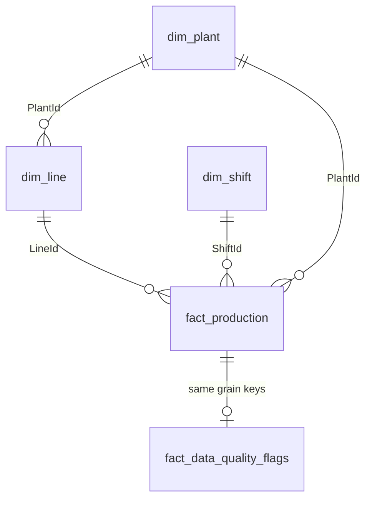

# Power BI Operations Dashboard (Databricks-style)

Portfolio demo for **plant / line / shift operational analytics** with a live-connection story (DirectQuery to Databricks) plus an **Import** CSV sample for local demos. Includes a dedicated **data-quality** page concept (gaps, anomalies, late-arriving records).

Synthetic data only — not connected to a real Databricks workspace.

## Problem

Operations leaders need:

- Trends in units good / scrap / downtime / OEE  
- Filters by date, plant, line, shift  
- Trust signals: missing shifts, late-arriving facts, volume anomalies  

## Solution architecture

```
Databricks Lakehouse tables  --DirectQuery-->  Power BI (production story)
         │
         └── CSV extracts (this repo) --Import-->  Power BI Desktop demo
```

| Mode | Use |
|------|-----|
| **DirectQuery** | Near-live ops boards; push filters to SQL warehouse |
| **Import** | Portfolio demo, offline review, model prototyping |

### Star schema



## How to open in Power BI Desktop

1. Load CSVs from `data/sample/` (Import).  
2. Relationships per `model/relationships.md`.  
3. Measures from `dax/ops_kpis.dax` and `dax/data_quality_flags.dax`.  
4. Pages: **Ops Trends**, **Plant Detail**, **Data Quality**.  
5. Slicers: ProductionDate, PlantName, LineName, ShiftName.

### DirectQuery (production sketch)

1. Databricks connector → SQL warehouse.  
2. Map views `gold.fact_production`, `gold.dim_*`.  
3. Keep measures foldable (avoid heavy iterators where possible).  
4. Target semantic model compressed size guidance: prefer **&lt; 100 MB** Import extracts for executive packs; use DQ for full history.

## Sample KPIs

| KPI | Definition |
|-----|------------|
| Units Good / Scrap | Sum of fact columns |
| Scrap % | Scrap ÷ (Good + Scrap) |
| Downtime minutes | Sum |
| OEE (avg) | Average of shift OEE |
| DQ flag count | Rows in quality flag fact |
| Late-arriving % | IsLateArriving ÷ production rows |

## Skills demonstrated

- Ops star schema (plant → line → shift facts)  
- DirectQuery vs Import narrative for lakehouse BI  
- Data-quality page with DAX flags for gaps / anomalies / late data  
- Model performance notes (&lt;100 MB Import guidance)  
- Power Query typing for production facts  

## Licence

MIT — synthetic demo data only.
