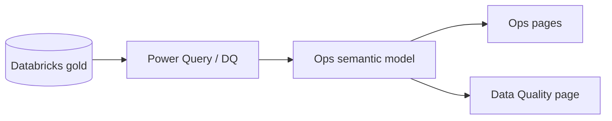

# Power BI — Databricks plant ops & data-quality dashboard

OEE, line/shift performance, and a first-class **Data Quality** page (late-arriving, gaps, anomalies) for lakehouse manufacturers. Sellable delivery bands **$4k–$30k**.



## Quick start
```bash
pip install -r requirements.txt
python scripts/generate_sample_data.py
python scripts/validate_schema.py
```

## Scale (v2)
fact_production **~46,700** · fact_data_quality_flags **~2,500**

## Licence
MIT
